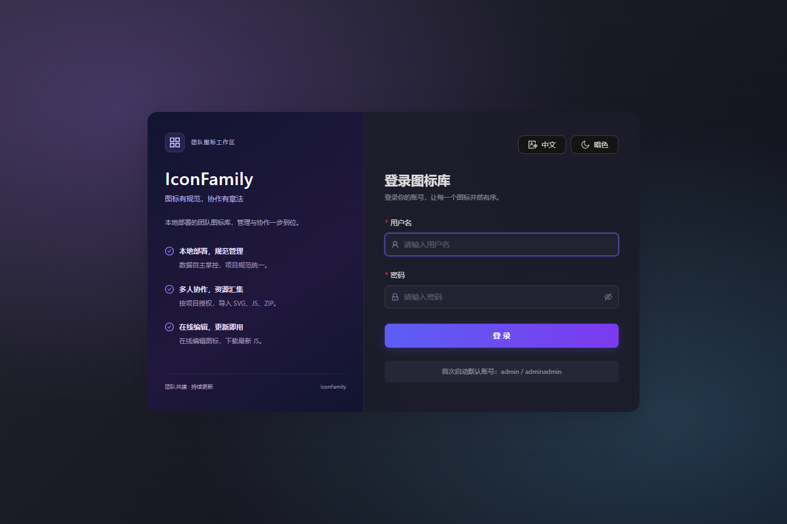
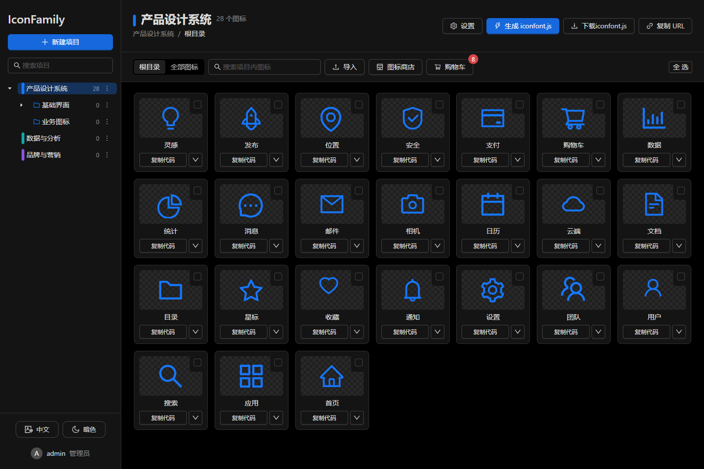
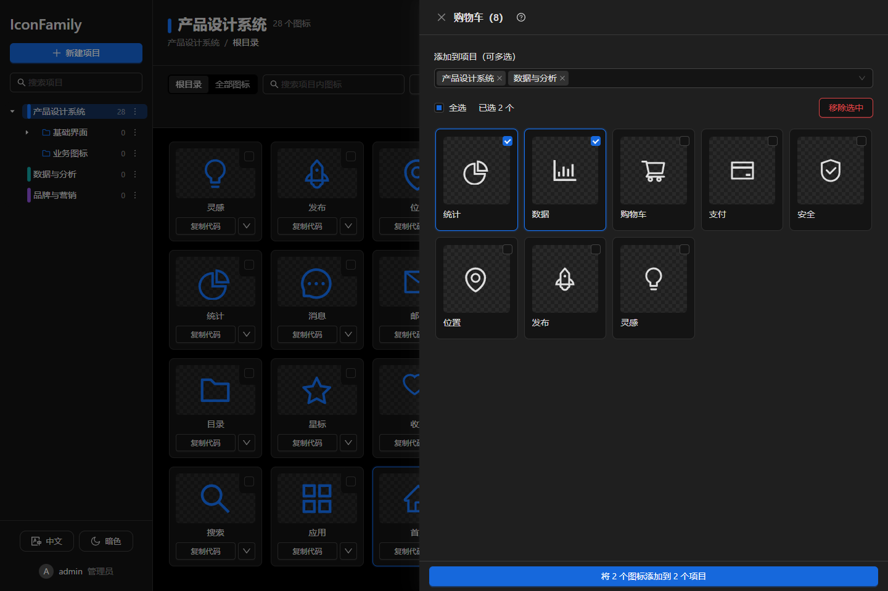
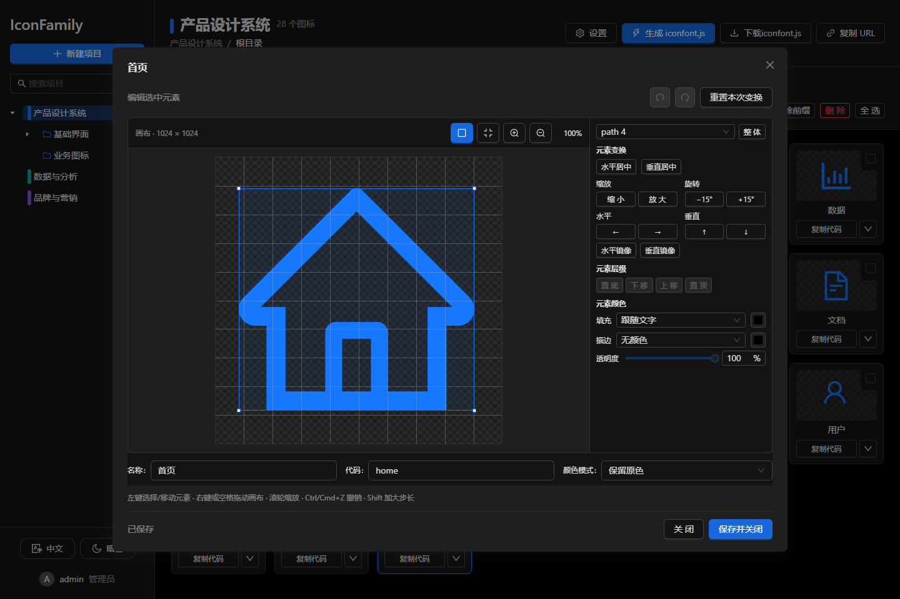
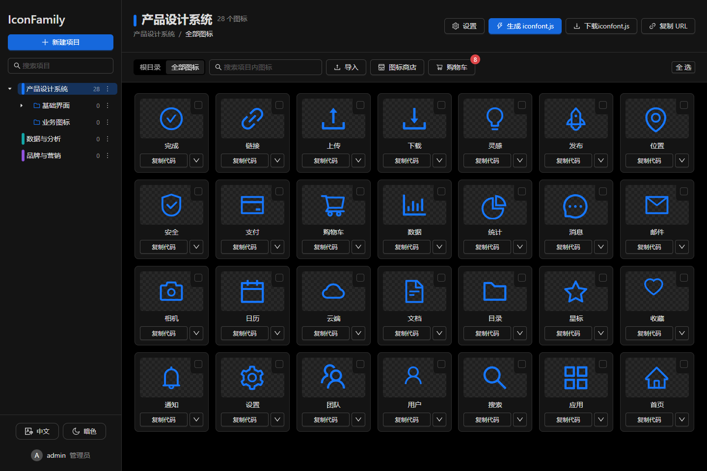

# IconFamily

**图标有规范，协作有章法。**

一个支持本地部署的团队图标工作区。把资源导入、项目管理、多人协作、在线编辑和 JS 分发放在一起，让图标从“找到了”到“项目里用起来”少走几步。

**图标更新后，固定地址自动提供最新 iconfont.js，也能一键下载最新 JS 文件。** 业务项目无需随着每次构建更换资源地址。

## 为什么做这个：苦 iconfont 久矣

找图标只是开始。真正落到项目里，还要统一命名、调整颜色和边距、分配协作权限、更新资源，再把最新文件交给开发使用。

我们想解决的，是这些反复出现的小麻烦：收藏和导入来回切换，批量选择不顺手，改一个图标却要刷新整片列表，资源越积越多却缺少目录，团队成员能编辑哪些内容也不够清楚。还有一个更朴素的愿望：自己的项目图标和修改结果，能保存在自己部署的服务里。

于是有了 IconFamily。保留从 iconfont 搜索资源的便利，也支持带着已有的 SVG、iconfont.js 和 ZIP 直接开始。找到的图标先加入购物车，整理后分发到项目；需要修改就在浏览器里完成，业务项目通过固定地址获取最新 JS。

这也是登录页上三句话的由来：

- **本地部署，规范管理**：数据自主掌控，项目规范统一。
- **多人协作，资源汇集**：按项目授权，导入 SVG、JS、ZIP。
- **在线编辑，更新即用**：在线编辑图标，下载最新 JS。

本地部署负责保存和管理资源；iconfont 商店的搜索仍需要访问上游服务。



## 已经实现了什么

### 项目与目录

- 项目和多级目录整合在同一棵树中，支持右键管理，文件夹图标跟随项目主题色。
- 目录可选，不建目录也可以完整使用。新导入图标默认进入项目根目录。
- 选中项目默认显示根目录，可切换“全部图标”；选中子目录只显示直属图标，不递归展示。
- 支持单个或批量移动图标；“拷贝到…”可选择目标项目及目录，默认当前项目和目录。
- 删除目录会连同子目录及其中图标一起删除，操作前显示影响数量并确认。
- 目录仅用于整理，不改变整个项目的 JS 导出范围，也不单独设置权限。
- 可设置项目主题色、图标代码前缀、默认边距和 JS 文件名。文件名输入 `abc` 自动补为 `abc.js`，不会额外拼接项目名前缀。



### 图标商店与持久化购物车

- iconfont 商店负责搜索和加入购物车，支持筛选、分页及颜色类型切换，并标记已加入的图标。
- 项目图标也可以通过右键菜单加入购物车。
- 购物车按用户隔离，加入时保存 SVG 数据快照，刷新或重启后仍保留，无需每次重新向 iconfont 获取图标。
- 商店和购物车均采用抽屉与图标矩阵，减少页面切换。
- 可将购物车中选中的图标一次添加到多个项目。全部目标处理成功后移出购物车；部分失败时保留，便于重试。



### 导入、编辑与导出

- 支持 SVG、静态 symbol 格式的 iconfont.js，以及包含支持资源的 ZIP。
- 文件可拖入或通过选择器打开，先校验、预览和勾选，再由用户确认导入。
- 在线 SVG 编辑器支持选中元素并高亮，调整平移、旋转、缩放、颜色、透明度及元素层级。
- 支持整个图标或选中元素水平、垂直居中，支持撤销与重做，右键拖动画布平移。
- 支持批量调整边距、去色、移除代码前缀和删除；图标代码也可独立轻量重命名。
- 卡片提供复制代码、复制 SVG、下载 SVG 和 PNG。PNG 可选 16 / 32 / 64 / 128 / 256 / 512 / 1024 px。
- 项目主题色用于预览中跟随文字的图标，保留图标自身明确设置的颜色。



### 账户与协作

- 管理员可创建、管理用户并重置密码；每个用户均可修改自己的密码。
- 管理员可按项目指定协作者，或开启“所有人可修改”策略，后续新用户同样获得访问和编辑权限。
- 协作者可管理图标和目录，但不能修改项目设置；项目设置和删除限管理员或创建者，协作授权由管理员管理。
- 目录沿用项目权限，避免维护多套授权规则。

### 自动提供最新 iconfont.js，一键下载

图标保存后，不必先手动点击“生成”才能获取更新：

1. **固定链接获取最新文件**：每个项目都有自己的 JS 地址。下一次请求时，服务端检查项目是否有更新；产物缺失或版本过期就自动构建，返回最新内容。
2. **一键下载最新 JS**：点击项目标题区的“下载 iconfont.js”，将最新文件保存到本地，方便放进业务代码仓库或自行发布到 CDN。
3. **复制 URL 直接接入**：点击“复制 URL”获取项目固定地址，业务页面可通过 script 标签加载。仍保留“生成 iconfont.js”按钮，支持提前手动构建。

下载文件名由项目设置决定：填写 `abc` 或 `abc.js`，下载名称都是 `abc.js`；不附加项目名前缀，留空则使用 `iconfont.js`。

“自动最新”发生在下一次请求资源时，不会主动替换已经打开的业务页面中的图标；重新加载资源后才会使用更新内容。下载到本地或自行上传 CDN 的副本，也需要重新下载、发布。

生成的 `iconfont.js` 使用 **SVG Symbol Sprite**，图标 ID 通常为 `项目代码前缀-图标代码后缀`。当前提供 JS、SVG 和 PNG 输出，尚未实现 TTF、WOFF、WOFF2 字体构建。

项目 JS 使用固定地址：

```text
GET /api/projects/{projectId}/javascript
```

这个地址无需登录或 API Token。已有构建与项目版本一致时直接复用；产物缺失或图标已修改时自动构建，再返回最新内容。它适合公开分发图标资源，不应视作私密下载地址。

例如项目代码前缀为 `demo`、图标代码后缀为 `home`：

```html
<script defer src="https://your-iconfamily.example/api/projects/5/javascript"></script>
<svg width="24" height="24" aria-hidden="true">
  <use href="#demo-home"></use>
</svg>
```

每个项目最多保留 **10 条构建记录及对应版本文件**，构建完成和服务启动时自动清理。连续构建失败时，会在保留名额中留下最后一次成功构建，保障下载可用；`latest.js` 是单独保留的当前产物副本。

## 为日常操作做的优化

| 场景 | 当前体验 |
| --- | --- |
| 大量图标加载 | 精简工作区接口字段、缓存 SVG 清洗结果、分批挂载卡片，让首批图标尽早出现；使用普通滚动，不使用虚拟列表 |
| 编辑保存 | 仅更新变更图标，避免重新请求整个矩阵 |
| 批量选择 | 默认单选，Ctrl / Cmd 多选、Shift 连选及拖动框选；右键操作与选中状态联动 |
| 长列表浏览 | 主界面仅图标区域滚动；商店筛选和页码固定，中间结果滚动 |
| 定位与恢复 | hash 路由记录项目、目录及全部视图，支持刷新、前进后退和登录后返回；目录失效时提示并回到全部视图 |
| 布局稳定 | 面包屑固定在标题区，弹窗采用紧凑布局，项目设置固定高度，用户表格分页 |
| 主题与语言 | 支持亮色 / 暗色、中 / 英文切换，并记住偏好；用户输入的图标名称保持原文 |
| 发布维护 | 前后端同仓库、同端口部署；生产构建不生成 sourcemap，历史构建自动限量清理 |



以上截图统一使用暗色主题，均来自应用实际运行页面，使用独立演示数据。

导入的 JS 仅做静态解析，不执行其中脚本。SVG 经过服务端内容校验，拒绝脚本、事件属性和不支持的外部资源，前端预览再做清洗。ZIP 校验路径、大小和解压限制。动态 JS 或不支持的 SVG 元素可能被拒绝，需要先转换为支持的静态资源。

## 快速开始

### 环境要求

- Node.js 22.15 或更高版本，建议使用当前维护的 Node.js 22 LTS 版本。
- 现代 Chrome、Edge 或 Firefox。
- 默认使用 Node 内置 SQLite，无需额外部署数据库。

### 本地开发

```sh
npm ci
npm run dev
```

打开 `http://localhost:5173`。一个命令同时启动 Vite 热更新和后端文件监听，开发服务器将 `/api` 代理到默认的 `3000` 端口。也可分别执行 `npm run dev:web`、`npm run dev:server`。

后端端口通过 `PORT` 环境变量设置。只调试前端时，可在 `.env.local` 中设置 `API_PROXY_TARGET=http://127.0.0.1:3001`，连接已有后端。仓库中的 VS Code 调试配置支持后端断点和浏览器调试。

### 从源码运行生产服务

```sh
npm ci
npm run build
npm start
```

打开 `http://localhost:3000`，页面和 API 由同一个服务提供。

首次启动默认创建 `admin` / `adminadmin`。部署前通过环境变量指定初始账号密码，或登录后立即修改。初始化变量不会重置已存在用户的密码。

### 打包后部署

```sh
npm run package
```

生成 `release/` 和 `iconfamily-<版本号>.zip`，包含编译后的前端及 Node 后端，不包含项目数据、开发依赖、开发脚本或 sourcemap。

目标机器安装符合要求的 Node.js 后，解压并执行 `npm start`、`start.cmd` 或 `sh start.sh` 即可，无需安装 npm 依赖。

### Docker 部署

先在 `docker-compose.yml` 中修改 `ADMIN_PASSWORD`，再运行：

```sh
docker compose up -d --build
```

访问 `http://localhost:3000`。前端在镜像构建阶段编译，运行阶段仅保留服务所需文件；数据保存在 `iconfamily-data` 卷中。当前 Compose 的环境变量为显式配置，仅修改宿主机 `.env` 不会覆盖其中的密码。

## 配置与数据

| 环境变量 | 默认值 | 用途 |
| --- | --- | --- |
| `PORT` | `3000` | 后端监听端口 |
| `HOST` | `0.0.0.0` | 后端监听地址 |
| `DATA_DIR` | `./data` | 数据目录，Docker 内为 `/data` |
| `STORAGE_DRIVER` | `sqlite` | `sqlite` 或适合单进程小规模部署的 `fs` 文件存储 |
| `ADMIN_USER` | `admin` | 初始化管理员用户名 |
| `ADMIN_PASSWORD` | `adminadmin` | 初始化管理员密码 |
| `ICONFONT_CA_FILE` | 未设置 | iconfont 请求使用的自定义 PEM 证书路径 |

`.env.example` 用于说明配置项，后端启动命令不会自动加载 `.env`，请通过运行环境或容器配置传入。`ICONFONT_INSECURE_TLS=1` 仅用于临时开发排查，不应在生产启用。

升级服务时保留数据目录或 Docker 数据卷。数据库、项目资源和构建产物都在该目录内，备份时应一并保存；SQLite 建议停服后复制整个目录，避免遗漏尚未合并的 WAL 数据。

## 技术结构与验证

前端采用 **React + TypeScript + Ant Design + Vite**，按功能拆分组件，使用普通 CSS，不使用 Tailwind。后端使用 Node.js 内置 HTTP、SQLite 等模块，支持 SQLite 和 JSON 两种存储方式。

```text
src/
  components/       通用 SVG 预览等组件
  layouts/          应用布局
  hooks/            路由、项目状态及交互
  features/
    auth/           登录、账户与用户管理
    projects/       项目设置与协作权限
    folders/        项目目录树与移动操作
    icons/          图标矩阵、商店、导入与导出
    cart/           持久化购物车
    editor/         SVG 编辑器
server/             API、存储、SVG 校验及构建清理
scripts/            打包、部署和运行验证
tests/              后端与浏览器测试
```

| 命令 | 用途 |
| --- | --- |
| `npm run typecheck` | TypeScript 类型检查 |
| `npm run test:server` | 存储、权限、导入安全、购物车、目录及构建保留测试 |
| `npm run test:e2e` | 构建并运行浏览器回归测试，首次需执行 `npx playwright install chromium` |
| `npm run test:runtime` | 打包后检查独立发布服务及开发代理，需要端口 3111、3112、5173 空闲 |
| `npm test` | 后端与浏览器测试 |
| `npm run format` | 格式化前端及相关配置、测试 |

浏览器测试使用独立临时数据与测试服务，不操作日常使用的项目数据。
