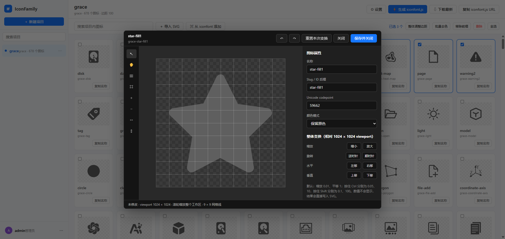

# IconFamily

一个单体部署的图标库管理器：左侧项目列表，右侧项目图标工作区，支持 SVG 导入、iconfont.cn 搜索导入、SVG 编辑、批量去色/调整边距/移除前缀，以及生成 `iconfont.js`。


[](./snipaste.png)


## 运行要求

- Node.js 22.15 或更高版本（使用内置 `node:sqlite` 和系统 CA，无需额外数据库）
- 浏览器建议使用最新版 Chrome、Edge 或 Firefox

## 本地启动

```text
npm start
```

打开 `http://localhost:3000`。首次启动会自动创建管理员账号，默认值为：

- 用户名：`admin`
- 密码：`adminadmin`

可以通过 `ADMIN_USER`、`ADMIN_PASSWORD`、`DATA_DIR` 和 `STORAGE_DRIVER` 环境变量覆盖默认值。`STORAGE_DRIVER=sqlite` 使用 SQLite（推荐），`STORAGE_DRIVER=fs` 使用 `metadata.json` 文件目录存储，适合单进程小规模部署。生产部署务必修改管理员密码。

iconfont 代理默认使用系统 CA；如果部署环境使用企业自签 CA，可设置 `ICONFONT_CA_FILE` 指向 PEM 文件。`ICONFONT_INSECURE_TLS=1` 仅用于临时开发排查，生产环境不要开启。

## 一键打包

```text
npm run package
```

产物位于 `release/`，同时会生成压缩包（Windows 使用 `Compress-Archive`，Linux/macOS 使用 `tar`）。压缩包解压后执行 `npm start` 即可运行；项目数据保存在 `data/`，不会被打包覆盖。

## Docker 一键部署

```text
docker compose up -d --build
```

数据持久化在 `iconfamily-data` 卷中，访问 `http://localhost:3000`。

## 功能说明

- 项目管理入口在左侧项目列表，不设置独立的项目管理页。
- iconfont 搜索通过后端代理 `POST https://www.iconfont.cn/api/icon/search.json`，避免浏览器跨域并统一清洗导入内容。
- 生成的 `iconfont.js` 是 SVG Symbol Sprite 格式，图标 ID 默认是 `项目此前缀-图标 slug`。
- 公开下载地址为 `GET /api/projects/{projectId}/iconfont.js`，无需登录或 Token；它会复用与当前项目 revision 一致的构建产物，缺失或过期时自动构建后返回最新文件。
- SVG 只允许安全的矢量内容；脚本、外链资源和 `foreignObject` 会被清除。
- 项目设置中保存一个 viewport 边距（默认 `100`）；新导入或从 iconfont 添加的图标会自动按该边距等比缩放并居中，批量调整边距会同时更新项目默认值。
- 升级后首次打开项目会自动修复旧版 iconfont 弧线路径造成的异常缩放/偏移，并清理导入名称中的项目名前缀。

iconfont 搜索界面会把关键词、排序、页码、每页数量、类型、集合和颜色筛选转为上游的 `application/x-www-form-urlencoded` 请求；`t` 由服务端实时生成，`ctoken` 默认按匿名搜索处理。
